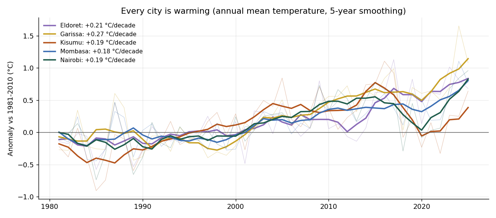
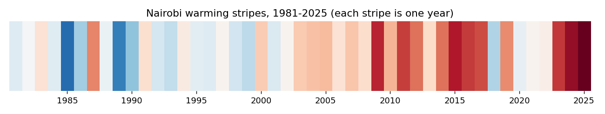
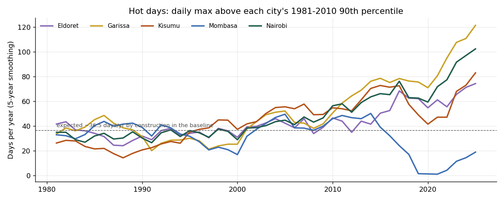
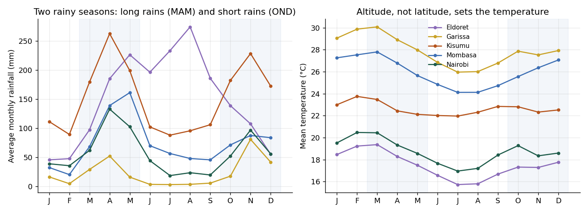
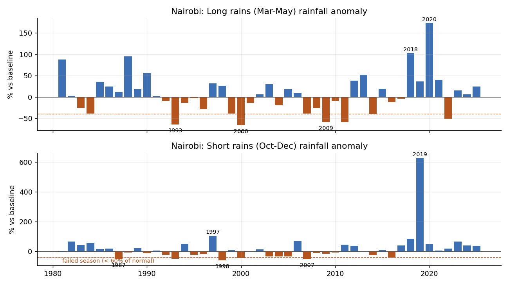

# Kenya Climate Trends, 1981–2025

How have temperature and rainfall changed in five Kenyan cities over 45 years? This project
analyses **82,180 days of weather** for Nairobi, Mombasa, Kisumu, Eldoret and Garissa:
long-term warming trends, the two rainy seasons, failed seasons, and hot days.

**Questions**
1. Is Kenya warming, how fast, and is the trend statistically robust?
2. Are daytime highs or night-time lows rising faster?
3. How reliable are the long rains (March–May) and short rains (October–December)?
4. Are hot days becoming more common?

## How to run

```bash
pip install -r requirements.txt
python src/fetch_data.py   # downloads daily data from the Open-Meteo archive API (no key needed)
python src/analysis.py     # writes figures/ and output/
```

## Method

- **Source:** the Open-Meteo historical archive, which serves the **ERA5 reanalysis** (ECMWF)
  for the grid cell containing each city.
- **Reference period:** 1981–2010 (a WMO-style 30-year normal). City-years with fewer than
  360 days of data are dropped.
- **Trends:** OLS slope per decade, plus a **Mann-Kendall test** (Kendall's τ against time)
  that doesn't assume a linear or normally distributed trend.
- **Seasons:** total rainfall for March–May and October–December. A season counts as
  *failed* when it gets less than 60% of its 1981–2010 average.
- **Hot days:** days when the maximum temperature is above that city's own 1981–2010
  90th percentile. By construction, about 36.5 such days a year are expected during the baseline.

## Findings

### 1. All five cities are warming, at 0.18–0.27 °C per decade

| City | Trend (°C/decade) | Mann-Kendall τ | p | Last 10 years vs 1981–2010 |
|---|---|---|---|---|
| Garissa | **+0.27** | 0.58 | < 0.001 | +0.77 °C |
| Eldoret | +0.21 | 0.50 | < 0.001 | +0.66 °C |
| Kisumu | +0.19 | 0.43 | < 0.001 | +0.29 °C |
| Nairobi | +0.19 | 0.46 | < 0.001 | +0.39 °C |
| Mombasa | +0.18 | 0.54 | < 0.001 | +0.50 °C |

Every trend is significant on both tests. In Nairobi, **2025 and 2024 are the two warmest
years** in the record (19.5 °C and 19.4 °C annual means).




### 2. Inland it's the days that are warming; on the coast it's the nights

| City | Daily max (°C/decade) | Daily min (°C/decade) |
|---|---|---|
| Nairobi | **+0.41** | +0.06 |
| Garissa | +0.41 | +0.17 |
| Eldoret | +0.33 | +0.16 |
| Kisumu | +0.32 | +0.19 |
| Mombasa | +0.01 (not significant) | **+0.26** |

In the four inland cities, daytime highs are rising two to seven times faster than night-time
lows. Mombasa is the reverse: daytime highs are flat and nights are warming. This fits the
moderating effect of the ocean on coastal maximum temperatures.

### 3. Hot days have doubled or tripled inland

Average number of hot days a year, first decade compared with last decade:

| City | 1981–1990 | 2016–2025 |
|---|---|---|
| Garissa | 37 | **92** |
| Nairobi | 30 | **77** |
| Eldoret | 31 | 64 |
| Kisumu | 21 | 63 |
| Mombasa | 36 | 14 |



Mombasa's fall is consistent with its flat daytime maximum temperatures, but its near-zero
count in 2019–2021 is suspicious (see *Limitations*).

### 4. Rainfall: huge year-to-year swings and no clear trend in Nairobi



- All five cities have two rainy seasons, though Eldoret's main rains continue into
  June–August.
- **Rainfall is far less predictable than temperature.** Nairobi's short rains have a
  coefficient of variation of **82%**, and its long rains 44%. In Garissa, a semi-arid town,
  the long rains vary by 74%.
- **Nairobi shows no significant trend** in either season (Mann-Kendall p = 0.82 for the long
  rains, 0.31 for the short rains). The record is dominated by individual events: the 2019
  short rains (a strong positive Indian Ocean Dipole year), the very wet 2018 and 2020 long
  rains, and failed long rains in 1993, 2000 and 2009.
- Failed seasons (under 60% of normal) are common. Since 1981, Nairobi has had 5 failed long
  rains and 6 failed short rains. Eldoret's short rains failed in 13 of 45 years.



## Limitations

Read the rainfall results with more caution than the temperature results.

- **These are reanalysis values, not weather-station readings.** ERA5 blends observations
  with a weather model on a grid of about 30 km. It reproduces temperature trends well, but
  it smooths rainfall extremes and has known biases over East Africa's mountains. The wettest
  single day in Nairobi in this dataset is only 64.6 mm, well below the extremes stations
  record.
- **Eldoret and Kisumu show large negative rainfall trends** (about −240 and −306 mm per
  decade annually, both p < 0.01). Their grid cells also show unrealistically high annual
  totals of around 2,000 mm. The direction of these trends needs checking against Kenya
  Meteorological Department station data before anyone uses it.
- **The Mombasa grid cell includes ocean.** Its collapse to almost no hot days in 2019–2021
  and its huge 2020 rainfall total are more likely artefacts of the grid cell than real
  weather.
- Nairobi's 2019 short-rains anomaly (+600%) has the right sign, because the season was
  exceptionally wet, but its size is exaggerated.

**Next step:** validate against station records from the Kenya Meteorological Department or
the CHIRPS satellite-gauge rainfall product, which is much better suited to East African
rainfall.

## Project layout

```
src/fetch_data.py    Open-Meteo archive download -> data/daily_weather.csv
src/analysis.py      trends (OLS + Mann-Kendall), seasons, failed seasons, hot days, charts
output/              trend tables, seasonal totals by year, hot and heavy-rain day counts
figures/             charts used above
```

**Data:** Open-Meteo Historical Weather API (CC BY 4.0), based on Copernicus ERA5 reanalysis.
